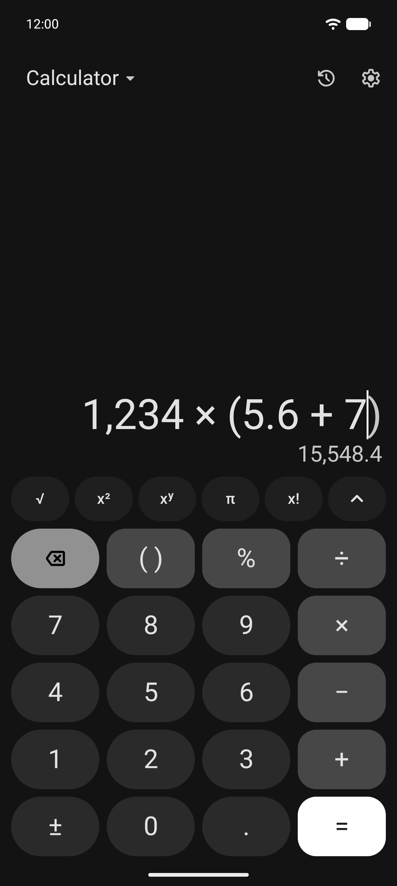
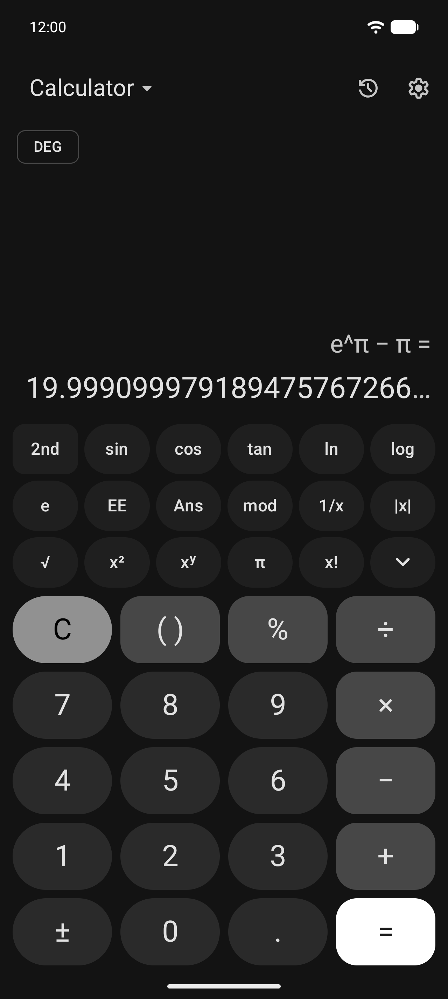
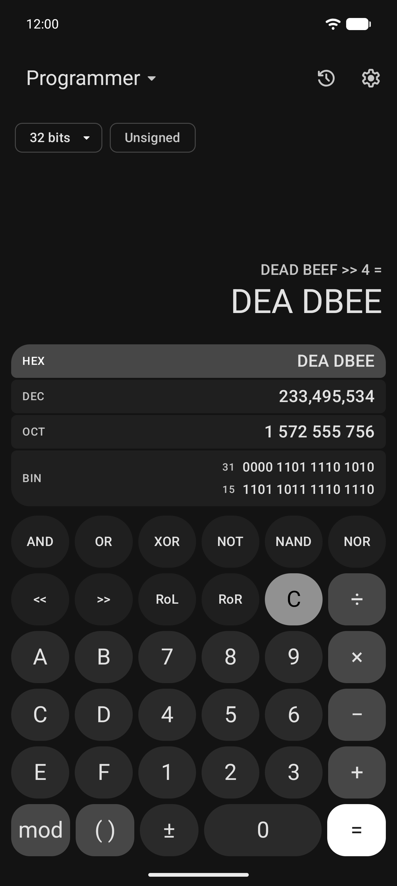
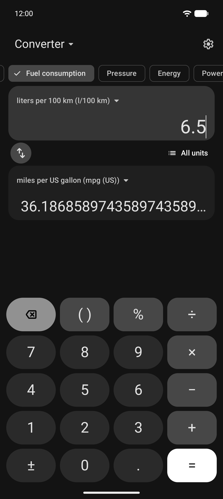
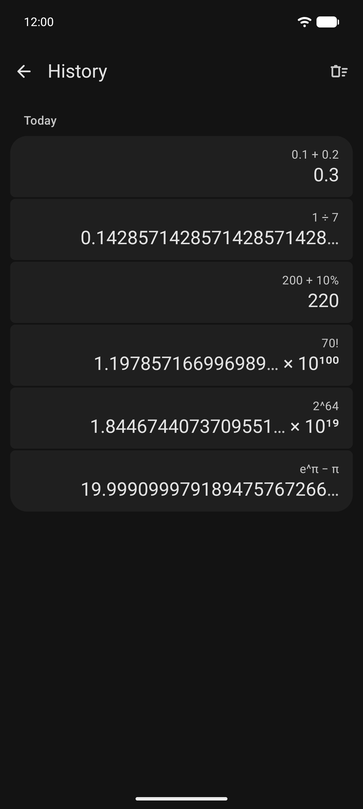
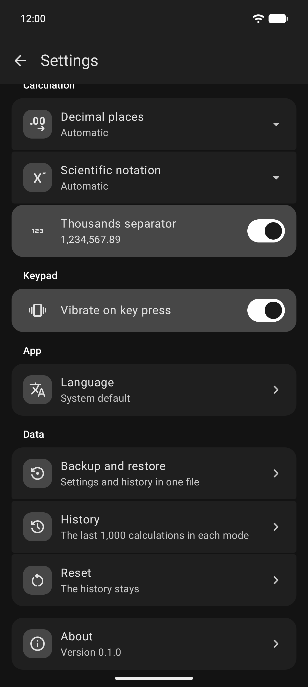

#  Calculator
 
A private calculator for Android: basic and scientific, programmer mode and a unit converter, with exact decimal arithmetic and no Internet access.
 
**Current version**: v0.2.1
 
Source code and releases: [git.hnet.sh/hkr/calculator](https://git.hnet.sh/hkr/calculator)
 
Bug reports and feature requests: [github.com/legal-hkr/calculator](https://github.com/legal-hkr/calculator/issues)
 
## Overview
 
Calculator calculates exactly: 0.1 + 0.2 is 0.3, and 1 ÷ 3 × 3 is 1. Irrational results are computed to as many digits as you scroll to, up to 1,000. It has no access to the Internet, asks for no permission at all and stores nothing outside the device: no account, no ads, no analytics.
 
## Screenshots
 
     
 
## Features
 
### Calculator
 
- **One line**: The whole expression with a cursor, its result previewed as you type
- **Exact**: Decimal arithmetic; a result with more digits ends with an ellipsis and scrolls sideways to show them
- **Notation**: Mathematical – 1 ÷ 2π is 1/(2π) – and percent as on phone calculators – 200 + 10% is 220
- **Scientific**: Trigonometric functions and their inverses in degrees or radians, logarithms, powers, roots, factorial, the last result
- **Copy and paste**: Plain text, so a copied number or expression pastes correctly anywhere
### Programmer
 
- **Bases**: HEX, DEC, OCT and BIN at once, words of 8 to 64 bits, signed or unsigned
- **Operations**: AND, OR, XOR, NOT, NAND, NOR, shifts and rotations; overflow wraps, with a note
- **Bits**: A sheet to toggle them one by one
### Converter
 
- **Categories**: 14, from length and mass to data, fuel consumption and frequency
- **Exact**: Factors from the units’ definitions; US and imperial units listed separately
- **Search**: Units by name or symbol in English and Polish, or all units of a category in one list
### Widget

- **On the home screen**: The four basic operations, percent and sign change, with the app’s exact arithmetic and a live preview
- **Its own calculation**: Each widget keeps its expression until cleared; nothing is added to History
- **Sizes**: Four cells wide; three rows high, or two with a single-line display
### Settings
 
- **History**: For Calculator and Programmer modes, with day groups, reuse, copy and delete; or none at all, with nothing kept after the app closes
- **Results**: Decimal places, scientific notation and the thousands separator
- **Backup and restore** of settings and history to a file you choose
- **Language**: English or Polish, independent of the system language
## Requirements
 
- Android 14 (API level 34) or higher
## Building
 
```bash
git clone https://git.hnet.sh/hkr/calculator.git
cd calculator
./gradlew assembleDebug
```
 
Set the Android SDK path in `local.properties` (`sdk.dir=…`) first. Unit tests run with `./gradlew test`.
 
## Contributing
 
Development happens on [git.hnet.sh](https://git.hnet.sh/hkr/calculator), where the releases are published too. The [GitHub repository](https://github.com/legal-hkr/calculator) is a read-only mirror, updated on every push, and the place to report problems:
 
- **Issues**: Open them on [GitHub](https://github.com/legal-hkr/calculator/issues), with the app version and your Android version
- **Pull requests**: Welcome on GitHub as well, but they can’t be merged there – accepted changes are applied on git.hnet.sh and reach the mirror from there, so the pull request itself ends up closed rather than merged
## Tech stack
 
- **Language**: Kotlin
- **Min SDK**: Android 14 (API 34), **target SDK**: API 37
- **UI**: Jetpack Compose with Material 3 Expressive
- **Arithmetic**: The app’s own engine – exact rationals, reals computed on demand, verified against mpmath and Wolfram Alpha
- **Data**: Room, DataStore
## License
 
[GPL-3.0](https://www.gnu.org/licenses/gpl-3.0.en.html)
 
## Acknowledgments
 
- [Claude](https://claude.ai) by Anthropic – AI assistant that provided valuable support during the development process, helping with code implementation, architecture decisions, and documentation
 